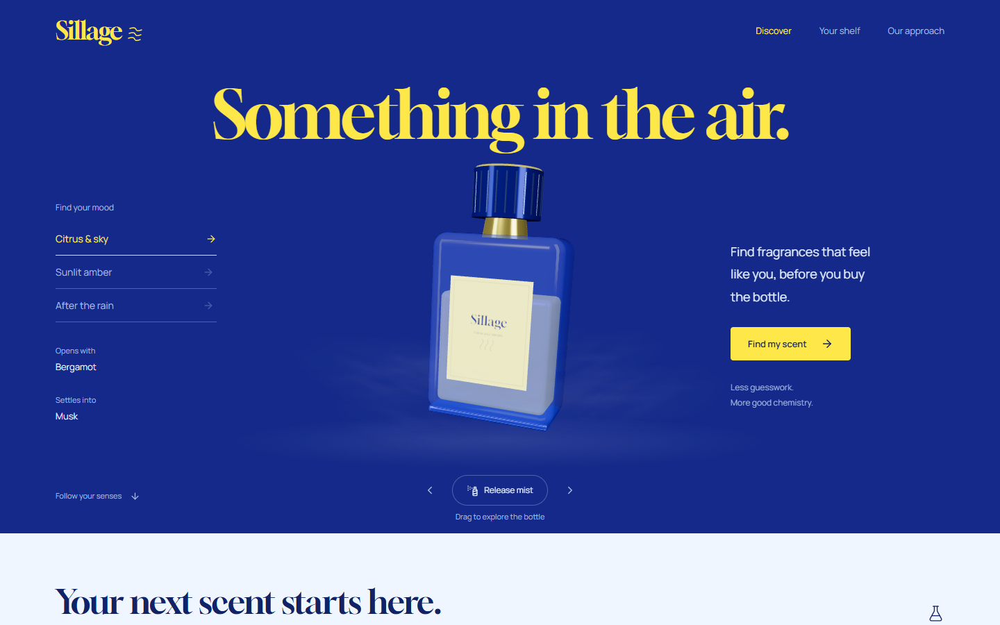

# Sillage

Find your next fragrance by the notes you love, a feeling you want, or a bottle you already know. Sillage turns its fragrance catalogue into an explainable shortlist for deciding **what to sample before buying a bottle**.

The blue-and-yellow discovery interface puts an interactive 3D cologne bottle at the center of the home page, surrounded by a soft mist atmosphere. Choose a scent mood, describe your ideal fragrance, or start with a bottle you already love. Search, note exclusions, your shelf, likes/dislikes, and side-by-side comparisons connect to the local cosine recommendation API. No API key, hosted database, model download, or paid service is required.



## Run locally

Requirements: **Python 3.12+** and **Node.js 24 LTS**. Run the following from the repository root.

```bash
python -m venv .venv
# Windows PowerShell
.venv\Scripts\Activate.ps1
# macOS / Linux
# source .venv/bin/activate
pip install -r backend/requirements-dev.txt
```

Start the API in one terminal:

```bash
cd backend
python -m uvicorn api:app --reload --host 127.0.0.1 --port 8000
```

Start the frontend in a second terminal:

```bash
cd frontend
npm ci
npm run dev
```

Open [localhost:5173](http://localhost:5173) with the API running. Vite forwards `/api` requests to the backend. Interactive API documentation is at [localhost:8000/docs](http://localhost:8000/docs).

If port 8000 is occupied, choose another port for Uvicorn and set `API_PROXY_TARGET` in the environment of the Vite process, for example `http://127.0.0.1:8107`.

## Discovery experience

The home page is a fragrance studio: ultramarine and lemon-yellow typography, a centered cobalt bottle, local Gloock/Manrope fonts, and a quieter pale-blue discovery workbench.

- **Explore the bottle:** drag to rotate, use the keyboard-accessible rotation buttons, or release a short mist burst. The atmosphere settles after 4.8 seconds rather than looping indefinitely.
- **Choose a mood:** Citrus & sky, Sunlit amber, and After the rain change both the visual bottle mood and the actual recommendation query.

- **Describe a scent:** try `warm vanilla sandalwood`, `fresh citrus for summer`, or `woody vetiver without rose`.
- **Start with a fragrance:** search a brand/name, select the exact bottle, and explore related scent profiles. The source bottle is excluded by its stable ID.
- **Refine:** exclude listed notes or accords, browse catalogue gender labels, and choose closest profiles or more variety. Unisex fragrances are included with men's and women's filters.
- **Understand the match:** open a result to inspect its top, heart and base notes, strongest shared features, cosine similarity, and original catalogue source.
- **Build your shelf:** save scents to try, like scents you enjoy, or dislike scents that don't work for you. Liked and disliked profiles affect subsequent searches when personalization is enabled.
- **Compare:** inspect up to three fragrances side by side, including their dry-down notes.

Your shelf is stored in this browser, up to 50 entries. Search sends the liked/disliked IDs to the API to construct that request's taste profile; it does not create a server-side account or feedback database. A saved bookmark alone is not treated as a positive rating. You can turn personalization off and remove entries at any time.

## Recommendation algorithm

The default engine is in [`backend/recommender.py`](backend/recommender.py). It indexes 23,845 distinct usable profiles from the current cleaned CSV; this number changes if the catalogue is updated.

1. Normalize and deduplicate notes and fragrance identities. Stable IDs come from source URLs. Names and brands are used for lookup, rather than contaminating scent vectors.
2. Build sparse features from top, heart and base notes with weights of `1`, `1.25` and `1.5`. Main accords start at weight `2`, declining with their listed position. These are initial heuristic weights, not measured note concentrations.
3. Apply sublinear term frequency and inverse document frequency, then L2 normalization. Rare scent features contribute more than common ones.
4. Recognize actual note/accord phrases, a small explicit synonym dictionary, and transparent mood expansions. This is bounded vocabulary matching, not an LLM interpreting arbitrary prose.
5. Add `0.65 × mean(liked profiles)` and subtract `0.35 × mean(disliked profiles)` from the query profile, then normalize again. These are heuristic relevance-feedback coefficients.
6. Score with **cosine similarity**: the dot product of unit-length scent vectors.
7. Apply exclusions and catalogue filters before selecting candidates. Recognized negations such as `without rose` are hard exclusions. Exclusions only cover the listed metadata; they are not ingredient or allergy guarantees.
8. Rerank up to 200 candidates (240 at the maximum result limit) with maximal marginal relevance: `(1 - diversity) × query similarity - diversity × maximum similarity to an already-selected result`. The default diversity weight is `0.15`; choosing closest profiles disables this adjustment.
9. Explain each match with the scent features contributing most to its cosine score.

The displayed similarity is **not a probability of satisfaction**. Filters and a diversity reranker do not manufacture confidence. Ratings from the imported dataset are not used for ranking because their quality has not been validated. No claim of better human recommendation accuracy has been established yet; the test suite checks behavior and mathematical correctness.

The underlying normalization and sparse cosine calculation follow [scikit-learn's TF–IDF documentation](https://scikit-learn.org/stable/modules/generated/sklearn.feature_extraction.text.TfidfTransformer.html) and [cosine similarity definition](https://scikit-learn.org/stable/modules/generated/sklearn.metrics.pairwise.cosine_similarity.html).

## Learning better weights

An optional, deterministic training tool is included in [`backend/train_weights.py`](backend/train_weights.py). It learns positive feature weights through gradient descent on pairwise logistic loss, while retaining weighted cosine similarity for retrieval.

**No trained model or real preference dataset is included.** The running baseline already fits corpus IDF statistics, but its note-layer and personalization weights are heuristics. Browser likes/dislikes personalize a request; they do not train a global model or silently upload training events.

Collect explicit, consented preference comparisons in JSONL, one object per line:

```json
{"user_id":"pseudonymous-user-id","query":"woody vanilla","positive_id":"catalogue-id-here","negative_id":"different-catalogue-id"}
```

Use actual 16-character IDs returned by `/catalogue` or recommendation results. The example above is a schema illustration, not training data. Both products should have been judged by the same user for that query; distinguish actual skin-test feedback from guesses and clicks. Exclusions remain a separate hard constraint.

```bash
cd backend
python train_weights.py /path/to/consented-feedback.jsonl --output /path/to/scent-weights.json
```

The tool requires at least 20 pairs from at least five users as a basic input guard. Those minimums are **not** a credible sample size for product-quality claims. It holds out 25% of users with a fixed seed, reports pairwise accuracy and logistic loss against unweighted cosine, and writes a candidate only if held-out accuracy does not worsen and loss improves. Weights are bounded between `0.25` and `4`. An independent test set, uncertainty estimates and online evaluation are still needed before promotion.

To explicitly enable an evaluated model, set `SCENT_WEIGHTS_PATH` to its absolute path before starting the API. The model must match the catalogue's feature/IDF signature, have finite weights of the expected dimension, and use the supported format. Invalid models fail startup. Removing the variable returns to the baseline. The health endpoint reports whether learned weights are active.

**Why this approach:** cosine is the scoring function; gradient descent is a way to learn its weights. Softmax could support a future candidate-selection training objective, but softmax outputs alone would not be calibrated buying confidence. A CNN is not the first choice for this unordered, sparse note metadata. Evaluate a learned metric or pairwise reranker against this baseline before adding a neural model.

## API

| Endpoint | Purpose |
| --- | --- |
| `GET /` | Health, usable catalogue size and active model status |
| `GET /catalogue?q=dior%20sauvage&limit=8` | Brand/name suggestions with stable IDs |
| `POST /search` | Query-based recommendations with preferences and exclusions |
| `POST /similar` | Recommendations from `cologne_id` or a fuzzy-matched `cologne_name` |

Example request:

```json
{
  "query": "woody vanilla without rose",
  "limit": 9,
  "avoid_notes": ["oud"],
  "liked_ids": [],
  "disliked_ids": [],
  "gender": "all",
  "diversity": 0.15
}
```

Limits: 1–24 results, up to 30 note exclusions, and up to 50 liked/disliked IDs per list. Unknown IDs, invalid filters, empty intent and oversized input are rejected. Unrecognized scent vocabulary returns an honest empty state. `/similar` preserves the original string-valued `matched` field and also returns the full `source` profile.

## Checks

With the Python environment activated:

```bash
python -m pytest backend/tests -q
cd frontend
npm run lint
npm run build
npm run test:e2e
```

Browser tests use installed Google Chrome with an isolated profile. Install it if needed with `npx playwright install chrome`. Tests start the frontend on 5177 and API on 8107 with one worker. Local runs may reuse services at those exact URLs; CI starts them fresh. Five browser flows cover real recommendations, exclusions, lookup, shelf persistence, comparison, errors, accessibility, responsive overflow, the centered bottle, mood-query wiring, and a mist burst that settles to a still frame. The workflow separately checks recommendation behavior through the Python tests, then frontend lint/build and browser checks.

The centered 3D bottle and mist use Three.js through React Three Fiber. The scene is lazy loaded, renders on demand, caps pixel density, uses local geometry and generated textures, and loads no remote models or fonts. Rotation is user controlled with drag and keyboard-accessible buttons. Mist uses deterministic local sprite textures and a finite animation. Reduced motion uses a static mist pose and immediate bottle rotation, and disables cosmetic transitions and the loading spinner. WebGL failure leaves the search usable. Three.js is pinned to r182 to match Fiber 9's Clock-based runtime without deprecation warnings; revisit both together when upgrading the renderer.

The production dependency audit is clean at the time of this update. The full npm audit still reports 12 moderate development-tool dependency advisories in the ESLint/minimatch tree; avoid a forced downgrade or incompatible transitive override as a shortcut. The lazy 3D bundle is kept separate from the search interface and triggers Vite's default size advisory.

## Deployment

Build the frontend with `npm run build` and serve `frontend/dist` using a static host. Provide either a same-origin `/api` reverse proxy to the FastAPI service, or set `VITE_API_URL` to the deployed API URL **before building**. The Vite development proxy does not exist in a static production build. Never put service secrets in `VITE_` variables.

Deploy the API with `backend/requirements.txt`, include `backend/data/fragrances_clean.csv`, and run `uvicorn api:app --host 0.0.0.0 --port $PORT` from `backend/` (use your host's port syntax). Set `CORS_ORIGINS` to the frontend origin(s), separated by commas. `.env.example` documents the environment variables; the API reads the process environment, so use your host's environment settings or Uvicorn's `--env-file` option for local files.

The catalogue is indexed once per process, with no network calls at startup. Each worker owns a copy of that index. Add a reverse proxy with request limits/rate limits and measure memory/latency before exposing a public deployment. No hosting credentials or existing production URL were supplied, so these changes do not provision or redeploy a hosted site.

## Data and limitations

The repository includes an imported Fragrantica dataset and earlier cleaning/embedding scripts. The main app uses `backend/data/fragrances_clean.csv`; the original Supabase/SentenceTransformer upload pipeline remains available as an optional experiment, with its own external dependencies. It is not required by the default API.

Imported notes are descriptive catalogue metadata, not verified formulas. Prices, availability, longevity, projection, batch changes and skin chemistry are not reliably represented. Source links let users inspect the original entries. Dataset provenance and redistribution rights should be verified before public/commercial redistribution; this repository does not establish a new licence for third-party data. Sampling remains the practical next step after a match.

The active frontend is `frontend/src/Discovery.tsx`. Its visual system is declared in `tokens.css`, with shared defaults in `base.css` and application styling in `sillage.css`. The original Vite `App.tsx` and styles remain as legacy reference files and are not mounted.

## Most useful next improvements

1. **A sample-first path:** link to verified decants/samples, record what users actually tried, and let them revisit their shortlist after a full day of wear.
2. **A short taste onboarding:** ask for two loved scents, one disliked scent, and which notes feel wrong. Offer a profile-only search for people who cannot name a bottle.
3. **Reliable price and availability:** connect licensed retailer data, distinguish bottle sizes and concentrations, and support a real budget filter only when current price coverage exists.
4. **Consented evaluation data:** collect explicit comparisons and post-sampling ratings, split evaluation by user and time, compare Recall/NDCG and satisfaction against the cosine baseline, and account for exposure/position bias.
5. **A wear diary:** collect skin-tested longevity, projection and weather/context with clear sample counts and uncertainty. Keep these separate from imported catalogue claims.
6. **Catalogue quality:** verify provenance, repair malformed names/ratings, identify concentration/reformulation differences, audit missing notes, and add licensed bottle photography.
7. **Shareable and portable shelves:** add optional accounts, cross-device sync, export and shareable comparisons without making sign-up a condition of discovery.

Prioritize sampling feedback and data quality before a larger neural model: the quality of the labels and the evaluation will set the ceiling.
